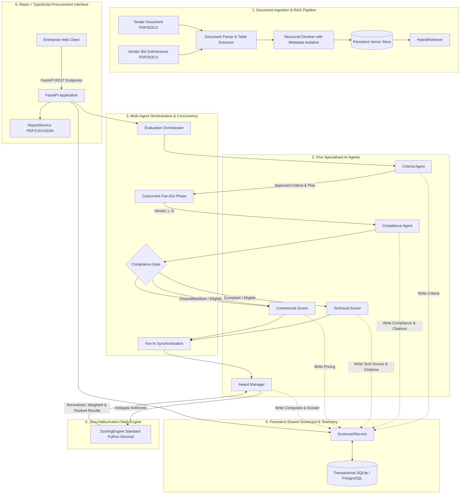

# FINAL_ARCHITECTURE.md — Multi-Agent Tender and Procurement Evaluation System

## 1. Executive Summary

The **Tender and Procurement Evaluation System** is an enterprise-grade, production-oriented autonomous multi-agent AI application designed to objectively evaluate multiple competing vendor proposals against a tender specification or Request for Proposal (RFP). The system replaces manual, error-prone, and biased procurement review processes with an evidence-backed, mathematically deterministic weighted scorecard and an auditable contract award recommendation dossier.

The architecture strictly adheres to **Human-in-the-Loop Governance**: AI agents generate objective findings and recommendations with status `AWAITING_HUMAN_APPROVAL`, leaving the final statutory award decision to authorized human procurement officers.

---

## 2. High-Level Architecture Diagram

---

## 3. Core Architectural Pillars

### 3.1 Strict Agent Specialization & Separation
The system decomposes procurement evaluation into five independent specialized agents, each governed by an isolated Python module:
1. **Criteria Agent** (`backend/app/agents/criteria_agent.py`): Solely responsible for tender analysis, extracting mandatory prerequisites (Pass/Fail), technical evaluation criteria (weights, max points, rubrics), and commercial evaluation formulas.
2. **Compliance Agent** (`backend/app/agents/compliance_agent.py`): Screens vendor bids against mandatory criteria, assigns `PASS`, `FAIL`, or `UNCLEAR`, and enforces disqualification.
3. **Technical Scorer** (`backend/app/agents/technical_scorer.py`): Conducts objective qualitative evaluation of compliant bids against technical rubrics, justifying every point allocation with exact citations.
4. **Commercial Scorer** (`backend/app/agents/commercial_scorer.py`): Extracts and normalizes pricing and rate cards; feeds financial proposals into the deterministic engine.
5. **Award Manager** (`backend/app/agents/award_manager.py`): Aggregates all results, executes cross-vendor relative lowest price formulas and composite weighting ($Score_{composite} = W_{tech} \times Score_{tech} + W_{comm} \times Score_{comm}$), produces rankings, and synthesizes an executive audit dossier.

### 3.2 Citation-Anchored RAG Pipeline
Every score, compliance finding, and justification is permanently anchored to an `EvidenceReference` record containing:
- `document_id`: UUID of source file
- `document_name`: Filename of the tender or bid proposal
- `page_number`: Exact page number in the original document
- `section_reference`: Heading or clause identifier (e.g., "Section 3.2: System Architecture")
- `verbatim_quote`: Exact unedited excerpt supporting the finding
- `confidence_score`: Extraction confidence metric (0.0 to 1.0)

### 3.3 Zero-Hallucination Deterministic Calculation Engine
Language models are strictly prohibited from performing mental arithmetic or computing scores. All calculations are executed by `ScoringEngine` (`backend/app/services/scoring_engine.py`) using Python's standard `Decimal` library with `ROUND_HALF_UP` rounding.

### 3.4 Transactional Persistent Shared Scorecard
Agents do not communicate through unstructured text chatter. All inter-agent data exchange and state mutation occurs through the `ScorecardService` (`backend/app/services/scorecard_service.py`), which executes transactional, idempotent, and coroutine-safe writes to the persistent database.

---

## 4. Multi-Agent Concurrency (Fan-Out / Fan-In)

The system achieves high-throughput evaluation by leveraging concurrent asynchronous execution:
1. **Phase 1 (Sequential)**: Criteria Agent processes the tender document and establishes the approved `EvaluationPlan`.
2. **Phase 2 & 3 (Fan-Out Concurrency)**: For $N$ competing vendors, the Orchestrator fans out concurrent tasks using `asyncio.gather`:
   - Each vendor bid is screened by `ComplianceAgent`.
   - If a vendor fails mandatory criteria, the `Compliance Gate` bypasses qualitative technical scoring while logging the audit rationale.
   - For eligible vendors, `TechnicalScorer` and `CommercialScorer` evaluate the technical capability and financial proposal.
3. **Phase 4 (Fan-In Synchronization)**: The Orchestrator waits for all independent vendor evaluation pipelines to complete, committing verified results to the shared scorecard.
4. **Phase 5 (Synthesis)**: `AwardManager` accesses the synchronized scorecard, benchmarks eligible bids, applies the commercial formula, computes final rankings, and writes the recommendation dossier.

---

## 5. Security & Prompt Injection Defenses

1. **Untrusted Data Isolation**: All uploaded RFP documents, vendor proposals, and price sheets are treated as untrusted data. They are never interpolated directly into prompt instructions.
2. **XML Delimiters**: Extracted passages are encapsulated inside `<untrusted_submission_content>` tags accompanied by defensive system instructions.
3. **Zero Dynamic Execution**: No agent or tool is permitted to execute dynamic code (`eval`, `exec`, shell scripts).
4. **Audit Trail**: Every agent step records start/completion timestamps, retry counts, execution logs, and error details in the `agent_executions` database table.

