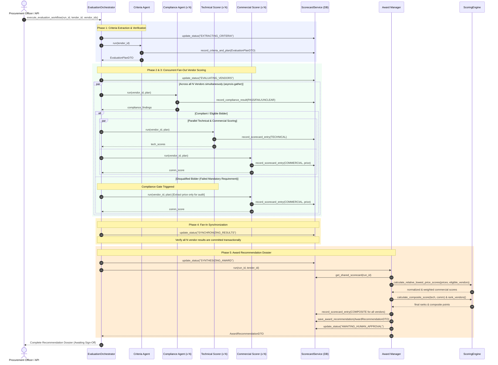

# ORCHESTRATION_FLOW.md — Multi-Agent Concurrency & Workflow Gates

## 1. Orchestration Architecture

The multi-agent workflow is orchestrated by `EvaluationOrchestrator` (`backend/app/orchestrator/evaluation_orchestrator.py`), enforcing sequential phase gates, concurrent fan-out parallel vendor evaluation, fan-in synchronization, and transactional scorecard commits.

---

## 2. Key Workflow Gates

### Gate 1: Criteria Approved Gate
- Before evaluating vendor bids, the system guarantees that mandatory requirements, technical criteria, weights, and commercial formulas exist and are valid.
- If not present, `CriteriaAgent` parses the RFP via RAG.
- Technical weights must sum to exactly 1.0000 ($\pm 0.0001$). Discrepancies abort the workflow with `CriteriaValidationError`.

### Gate 2: Compliance Screening Gate
- `ComplianceAgent` screens each vendor bid against every mandatory requirement.
- Any requirement evaluated as `FAIL` immediately flags the vendor as `is_disqualified = True`.
- **Compliance Gate Behavior**: Disqualified vendors have qualitative technical scoring bypassed (`len(technical_scores) == 0`). Their pricing is still captured for auditable cost benchmarking, but they cannot win or set the lowest-price benchmark.
- Any requirement evaluated as `UNCLEAR` flags the vendor as `requires_human_review = True` and records an entry in the procurement risk assessment.

### Gate 3: Relative Lowest Price Benchmark Gate
- When executing the commercial formula, the lowest price ($P_{min}$) is computed **strictly among eligible (compliant) bidders**:
  $$P_{min} = \min \{ P_v \mid v \in \text{CompliantVendors} \}$$
- Disqualified vendors submitting low-ball prices are excluded from establishing $P_{min}$, preventing predatory or non-compliant bids from distorting the scoring curve.

### Gate 4: Human Governance Sign-Off Gate
- The multi-agent evaluation pipeline concludes with status `AWAITING_HUMAN_APPROVAL`.
- An authorized procurement officer reviews the dossier and submits a signed decision via `POST /api/v1/evaluations/{run_id}/sign-off`:
  - `APPROVE_AWARD`: Formal award approval. Status advances to `AWARD_APPROVED`.
  - `OVERRIDE_WINNER`: Officer selects alternate compliant vendor with recorded justification. Status advances to `AWARD_OVERRIDDEN`.
  - `REJECT_ALL`: All bids rejected. Status advances to `AWARD_REJECTED`.

